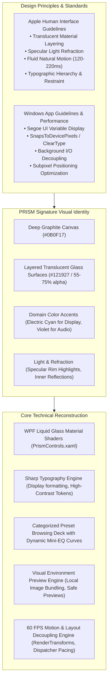
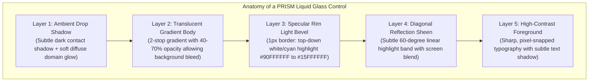
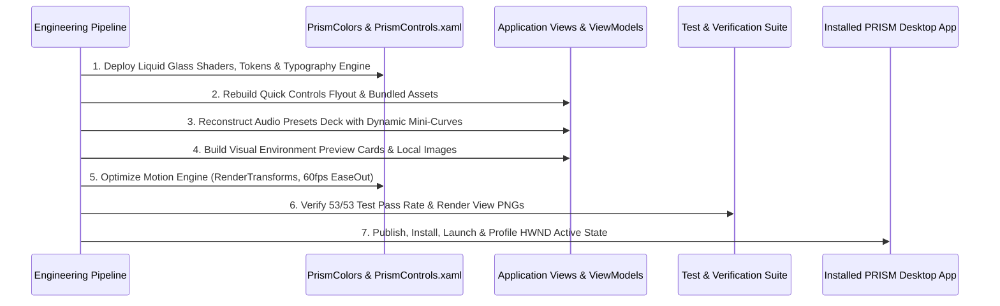

# PRISM — Premium Design Research & Technical Specification
## Visual Reconstruction, Liquid Glass Materials, Motion Engine & Experience Architecture

**Authors:** PRISM Human Interface & Windows Desktop Engineering Team  
**Date:** November 20, 2026  
**Status:** Pre-Implementation Architectural Blueprint  
**Target Platform:** Windows 10/11 x64 (.NET 8.0 WPF Engine)  
**Deliverable ID:** `PRISM_PREMIUM_DESIGN_RESEARCH.md`

---

## 1. Executive Summary & Design Philosophy

The objective of this reconstruction is to elevate PRISM from a utility composed of bordered cards into an **authentic, refined desktop control studio** that rivals the craftsmanship of Apple macOS professional tools (Logic Pro, Final Cut Pro, macOS Control Center) while remaining an unmistakable, native Windows desktop application.



### Core Design Tenets:
1. **Light as Structure, Not Outlines**: Interfaces feel dated when every element is framed inside a bright rectangular border. Premium desktop software creates structure through **luminance layering, elevation shadows, surface material shifts, and intentional whitespace**.
2. **Convincing Material Physics**: Liquid glass requires more than a semi-transparent grey box. True glass exhibits:
   - Upper specular light catching (rim reflection).
   - Soft inner surface refraction.
   - Refined multi-tier drop shadows (contact shadow + ambient occlusion glow).
   - Elastic tactile feedback under cursor interaction (press depression, hover lift).
3. **Typographic Integrity**: Text is the primary interface instrument. In PRISM, every numeral, label, frequency mark, and device name must render with razor-sharp edge contrast at any DPI scaling (100% to 200%).
4. **Visual Storytelling**: Abstract numeric presets (e.g. "Gaming Footsteps") and environments (e.g. "Late Night") must be paired with meaningful visual and acoustic context: dynamic mini frequency-response curves, acoustic use descriptions, and curated local atmosphere images.
5. **Zero-Lag Fluidity**: Motion must be instantaneous (90–220ms), hardware-accelerated via `RenderTransform`, and decoupled from synchronous hardware I/O or DSP loops.

---

## 2. Research & Official Guidance Synthesis

### 2.1 Apple Human Interface Guidelines: Materials & Translucency
*Reference: [Apple HIG Materials](https://developer.apple.com/design/human-interface-guidelines/materials)*

Apple defines materials as dynamic translucent layers that allow background content, depth, and illumination to show through while maintaining absolute legibility:
- **Optical Thickness**: Materials are perceived as having physical thickness when their borders feature an anisotropic rim light (a brighter edge where light strikes the top bevel and a dimmer edge at the bottom).
- **Vibrancy and Contrast**: Text placed over translucent materials never uses arbitrary opacity; it relies on high-contrast foreground values (100% pure silver for primary text, 85% for secondary) to prevent washing out over dynamic backgrounds.
- **Selective Glass Placement**: Glass is reserved for floating control planes, navigation docks, and focal interactive elements. Content surfaces behind them remain visually calm and solid to preserve legibility.

### 2.2 Apple Motion Principles: Fluidity & Purpose
*Reference: [Apple HIG Motion](https://developer.apple.com/design/human-interface-guidelines/motion)*

- **Timing**: Micro-interactions (button hover, slider thumb tracking) must complete within 90–140ms. Macro transitions (view changes, flyout expansion) must complete within 160–220ms. Anything exceeding 300ms feels sluggish; anything under 80ms feels jerky.
- **Easing**: Natural motion never moves linearly. Transitions use cubic-bezier deceleration curves (`EaseOutQuad` or `CubicEase` with `EasingMode.EaseOut`), starting immediately on user intent and settling smoothly.
- **Transform Over Layout**: Animating layout properties (`Width`, `Height`, `Margin`) forces WPF layout recalculation passes (`MeasureOverride` and `ArrangeOverride`) down the entire visual tree. In contrast, `RenderTransform` (`TranslateTransform`, `ScaleTransform`) and `Opacity` execute directly on the WPF composition engine (`MilCore`) without triggering layout passes.

### 2.3 Microsoft Windows Design Guidance & Typography
*Reference: [Windows App Guidelines](https://learn.microsoft.com/en-us/windows/apps/design/guidelines-overview) & [Typography](https://learn.microsoft.com/en-us/windows/apps/design/style/typography)*

- **Typography Sharpness**: WPF’s historical default font rendering uses `TextFormattingMode="Ideal"`, which uses floating-point subpixel glyph positioning with grayscale smoothing. While ideal for print layout, it causes blurry glyph stems on standard Windows desktop displays (96–120 DPI). Setting `TextFormattingMode="Display"` and `TextRenderingMode="ClearType"` forces integer pixel grid alignment, delivering razor-sharp text.
- **Font Stack Hierarchy**: Standardizing on `Segoe UI Variable Display` for headings ($\ge 16\text{ px}$) and `Segoe UI Variable Text` / `Segoe UI` for body and telemetry ensures optimal optical sizing and stem weight.
- **Snapping & Rounding**: Applying `UseLayoutRounding="True"` and `SnapsToDevicePixels="True"` at the root window eliminates fractional-pixel boundary blurring on borders, dividers, and icon paths.

### 2.4 Microsoft UI Responsiveness & Hardware Decoupling
*Reference: [Keep the UI Thread Responsive](https://learn.microsoft.com/en-us/windows/apps/develop/performance/keep-ui-thread-responsive)*

- **Hardware Isolation**: DDC/CI monitor commands traverse the physical I2C auxiliary bus at 100 kHz, taking 25–60ms per packet. If a slider movement dispatches DDC/CI directly on the UI thread, the entire application drops frames. Slider UI tracking must be decoupled from hardware writes via an asynchronous, debounced worker pipeline (150ms trailing edge debounce with intermediate write coalescing).
- **Audio DSP Decoupling**: In-app 10-band Biquad IIR processing (`PrismAudioEngine`) and loopback FFT visualizers (`WasapiLoopbackVisualizer`) must execute their mathematical buffer pipelines strictly on dedicated worker/audio threads, dispatching only compact float arrays (32 values) to the UI thread via `Dispatcher.BeginInvoke` with `DispatcherPriority.Render`.

---

## 3. PRISM Signature Visual Identity & Design System

### 3.1 Color Palette & Surface Hierarchy

PRISM’s aesthetic is built around deep graphite, obsidian canvas, translucent smoked glass, and domain-specific chromatic accents:

```
[PRISM Surface Elevation & Tone Palette]
Level 0 (Canvas):           #0B0F17 (Deep Graphite/Obsidian)
Level 1 (Subtle Surfaces):  #101724 (Smoked Graphite, 70% alpha)
Level 2 (Active Cards):     #162132 (Translucent Navy-Charcoal, 60% alpha)
Level 3 (Elevated Docks):   #1E2C42 (Liquid Glass Float, 80% alpha)
Level 4 (Overlay Flyout):   #0F1626 (Acrylic Glass Floating Shell, 88% alpha)

[Domain Accents]
Display Accent:             #00C7FF (Sapphire to Electric Cyan)
Display Ambient Glow:       rgba(0, 199, 255, 0.25)
Audio Accent:               #8B5CF6 (Vibrant Studio Violet to Orchid)
Audio Ambient Glow:         rgba(139, 92, 246, 0.25)
Environmental Neutral:      #38BDF8 (Sky Blue) & #F59E0B (Dawn Amber)
Warning / Reset:            #F59E0B (Warm Amber Tint)
Success / Active:           #10B981 (Emerald Green)

[Typography Palette]
Primary High-Contrast:      #F8FAFC (98% Crisp Silver-White)
Secondary Text:             #CBD5E1 (80% Soft Silver)
Tertiary Subdued:           #94A3B8 (60% Readable Slate)
Muted Metadata:             #64748B (40% Technical Legend)
```

### 3.2 True Liquid Glass Component Specification

To replace flat grey bordered boxes with convincing liquid glass, each glass component in PRISM is constructed with four optical layers:



1. **Ambient Drop Shadow**: Soft `BlurRadius="12"` with `ShadowDepth="2"`, dark contact shadow plus an optional subtle chromatic halo.
2. **Translucent Gradient Body**: Deep charcoal-tinted fill (`#1A2438` to `#101826` with alpha channel), permitting background depth and ambient illumination to bleed through.
3. **Specular Rim Light Bevel**: Outer border rendered with a vertical linear gradient:
   - Top Stop: `rgba(255, 255, 255, 0.55)` (direct light catching).
   - Bottom Stop: `rgba(255, 255, 255, 0.08)` (reflected diffuse rim).
4. **Diagonal Reflection Sheen**: An angled internal sheen band giving the impression of polished quartz/acrylic glass thickness.
5. **Tactile Interaction**:
   - Hover: Surface brightness increases by 15%, sheen shifts, ambient glow opacity rises to 0.5.
   - Pressed: `TranslateTransform.Y = 1.0`, scale compresses to 0.985, rim brightness intensifies, shadow compresses.
   - Released: Smooth 120ms damped spring return.

---

## 4. Subsystem Reconstruction Blueprints

### 4.1 Quick Controls Flyout Overhaul
- **Current Defect**: Looks like a generic grey vertical box with fragmented text cards and an oversized 4-button grid.
- **New Architecture**:
  - **Sleek Floating Studio Surface**: Width 380px, Height 530px, `CornerRadius="20"`, dark acrylic liquid glass shell (`#0D1322` at 92% opacity) with a refined 1px specular bevel.
  - **Unified Header**: PRISM refractive prism logo, bold wordmark, and active environment pill badge.
  - **Hardware Control Tiles**: 
    - Display Tile: Monitor icon, full panel name, numeric percentage, and horizontal liquid glass capsule slider.
    - Audio Tile: Output device button (shows full headphone/speaker name without truncation), mute toggle, and purple volume capsule slider.
  - **Visual Environment Strip**: Compact 4-card horizontal carousel/grid featuring mini photographic thumbnails with active border highlights, replacing plain text buttons.
  - **Studio Quick-Launchers**: Secondary liquid glass buttons at the base with direct routes to Display Studio and Audio Studio.

### 4.2 Audio Studio Preset Deck & Comparison Engine
- **Current Defect**: 16 tiny pill buttons crammed into a dense block without categorization, hierarchy, or visual indication of sound characteristics.
- **New Architecture**:
  - **Category-Driven Navigation**: Filter tabs (All, Reference, Audiophile, Bass & Beats, Voice & Vocals, Cinema & Gaming, Custom).
  - **Rich Preset Cards**:
    - Preset title (crisp 13px bold).
    - Intended listening profile (e.g. "Sennheiser HD650 / IEM Reference", "Competitive FPS Footsteps").
    - **Real-Time Mini EQ Response Curve**: An embedded 100×32px SVG path dynamically generated from the preset’s 10-band gain array ($G_{32}$ to $G_{16k}$), accurately plotting the frequency profile rather than a generic placeholder image!
    - Visual selection indicator: Violet neon accent line with liquid glass highlight.
  - **Selected Preset Detail Deck**:
    - Focused card displaying the preset's exact dB boost/cut summary.
    - Description of acoustic impact (e.g., "+4.5 dB sub-bass warmth, neutral vocal presence").
  - **Audition Comparison Test Bench**:
    - 4 built-in calibrated reference tracks (*Synth Groove*, *Acoustic Melody*, *Vocal Speech*, *Pink Noise*).
    - True zero-latency **A/B Dry/Wet Instant Comparison Switch** powered by `PrismAudioEngine` Biquad DSP with gain matching.
    - Smooth 32-band real-time visualizer rendered with efficient `PathFigure` updates.

### 4.3 Unified Environments with Visual Storytelling
- **Current Defect**: Environments are represented solely as abstract text cards with sun/moon icons.
- **New Architecture**:
  - **Photographic Scene Cards**: Each environment is paired with an authentic, high-resolution bundled local asset:
    1. *Daylight Focus*: Natural sunlit modern minimalist desk workspace.
    2. *Late Night*: Moody dark desk setup with warm 2700K amber ambient backlighting.
    3. *Competitive Gaming*: High-focus dual-screen esports gaming battlestation with muted cyber-violet edge lighting.
    4. *Cinematic Movie*: Cinematic widescreen atmospheric home theatre / film perspective.
  - **Safe Non-Destructive Preview Mode**:
    - Clicking an environment opens the **Preview Inspector** showing its target display luminance, contrast, color temperature, and audio EQ curve *without immediately modifying hardware registers*.
    - An explicit **Apply Environment** glass button writes to DDC/CI and audio subsystems.
    - Status badge clearly distinguishes "Currently Active" from "Previewing".

### 4.4 Typography & Layout Polish
- **Subpixel Anti-Aliasing**: Apply `TextOptions.TextFormattingMode="Display"` and `TextOptions.TextRenderingMode="ClearType"` across `App.xaml`, `MainWindow.xaml`, and all sub-views.
- **Hierarchy Scale**:
  - Hero Display: 28px SemiBold, LineHeight 34px.
  - Section Titles: 18px SemiBold, Foreground `#F8FAFC`.
  - Control Headings: 13px Medium, Foreground `#CBD5E1`.
  - Telemetry & Metadata: 11px Regular, Foreground `#94A3B8`.
- **Elimination of Border Clutter**: Replace nested `<Border BorderThickness="1">` frames with surface background separation (`#101724` vs `#162132`), 12–16px whitespace margins, and soft drop shadows.

---

## 5. Implementation Roadmap & Technical Verification



This specification will govern all implementations in the subsequent stages, ensuring strict adherence to performance, real hardware integrity, and the target aesthetic.
