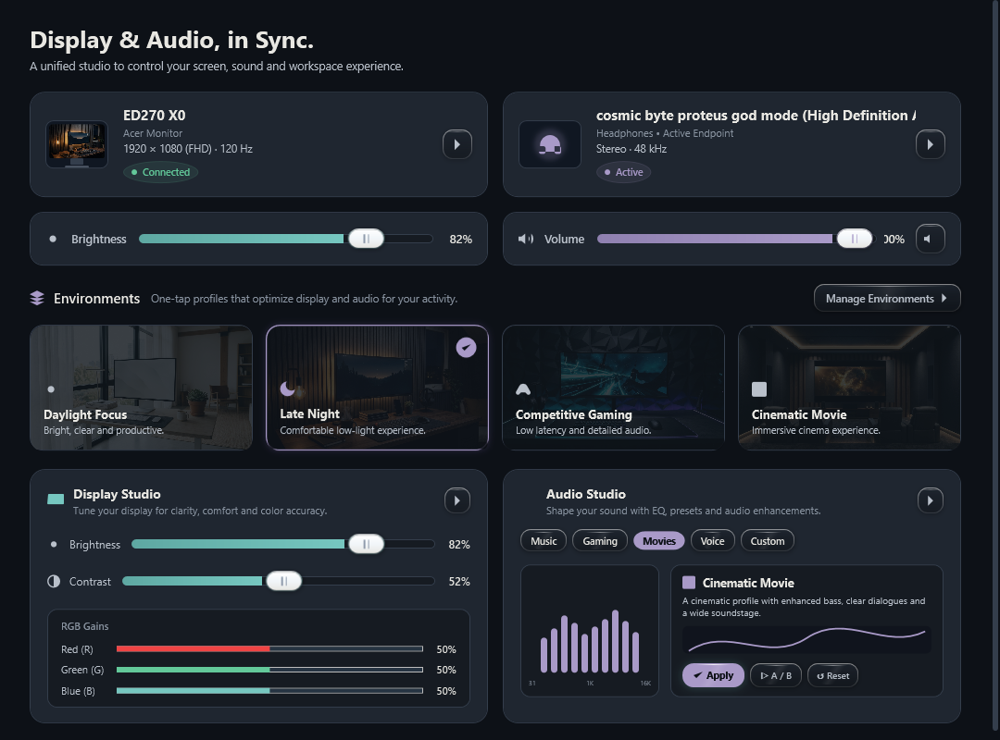
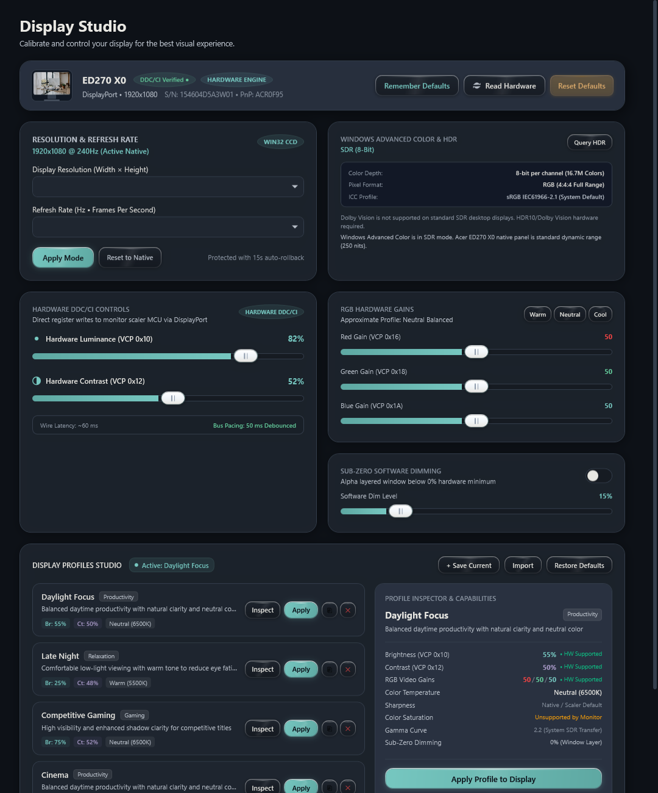
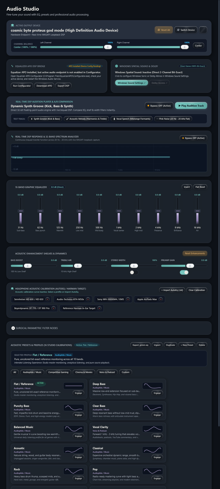
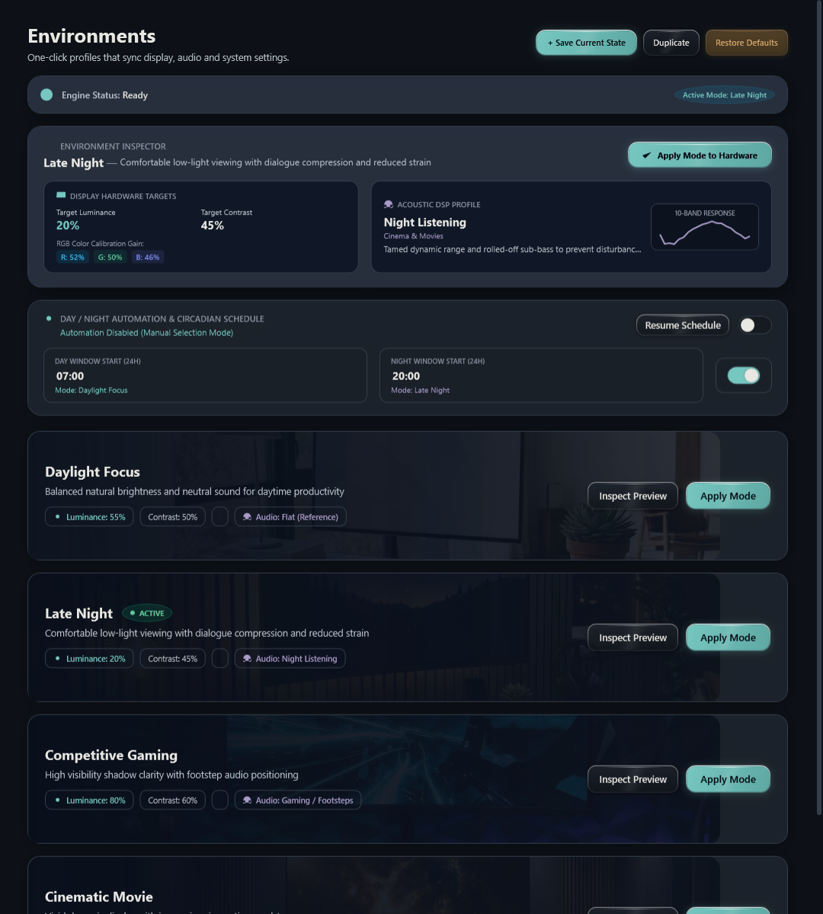
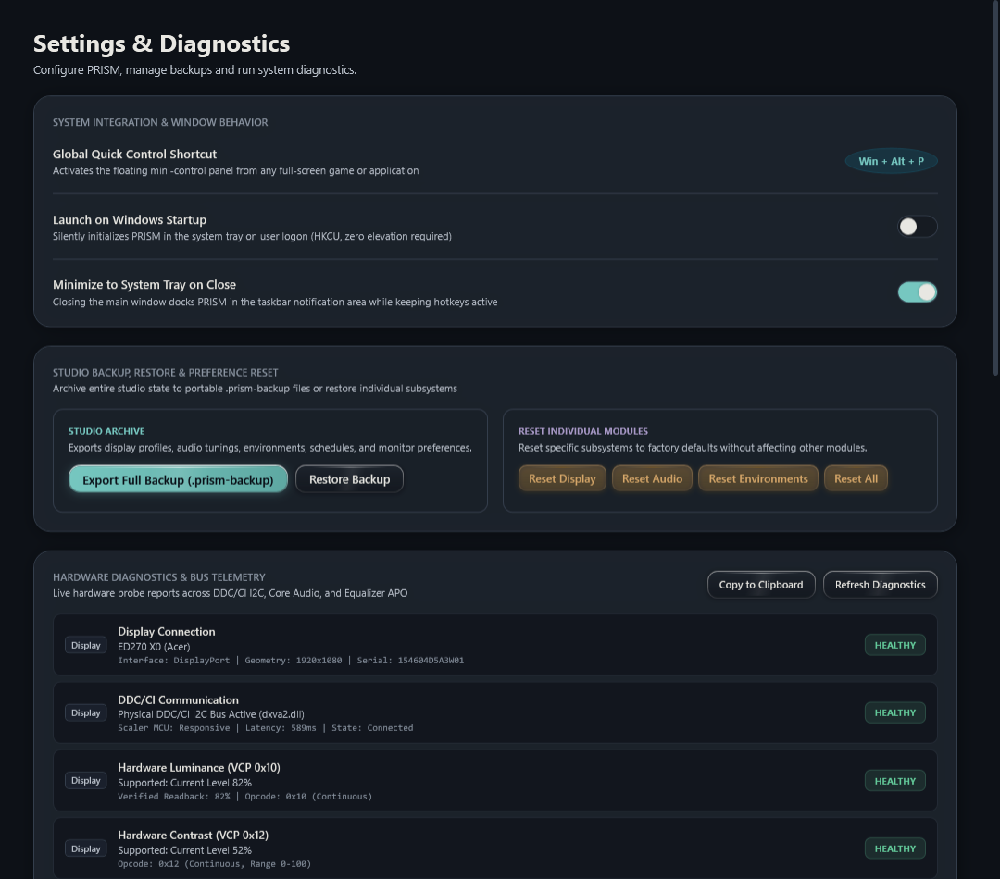
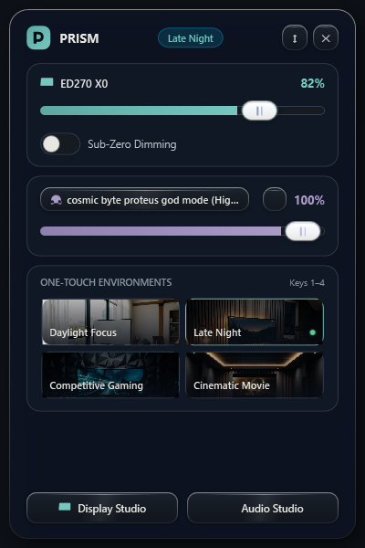

# PRISM — Windows Display & Audio Studio

<div align="center">



**A high-performance, native Windows Display & Audio Control Studio engineered with C#/.NET 8, WPF, and MVVM.**

[-blue.svg?style=flat-square)](#system-requirements)
[](https://dotnet.microsoft.com/download/dotnet/8.0)
[](#midnight-graphite-design-system)
[](#display-studio)
[](#audio-studio)

</div>

---

## Overview

**PRISM** replaces clunky physical monitor OSD buttons and disjointed Windows settings dialogs with a unified, studio-grade desktop experience. Engineered for desktop monitors connected over DisplayPort, HDMI, or DVI, PRISM delivers direct hardware register manipulation alongside precision audio DSP and synchronized environment profiles.

---

## Key Features

### 🖥️ Display Studio (Direct DDC/CI Hardware Control)
- **Direct VESA DDC/CI Communication:** Communicates with monitor scalers over $I^2C$ clock/data lines (`0x37`) using Windows DXVA2 `LowLevelMonitorConfiguration` APIs.
- **Hardware Coalescing & Settling:** Debounced hardware dispatch pipeline eliminates bus flooding during rapid slider adjustments, with calibrated 650 ms EEPROM settling delay for readback stability.
- **Color Balance (RGB Gains):** Fine-grained Red, Green, and Blue hardware gain adjustments with profile baseline restoration.
- **Win32 CCD Integration:** Native display enumeration reporting active refresh rates (e.g. 144Hz, 165Hz, 240Hz), native resolution, and color depth (SDR 8-bit / HDR 10-bit).
- **Selection Isolation:** Clicking profile cards previews values in the inspector **without mutating physical monitor registers** until explicitly applied.
- **Change Tracking:** Live badges indicate unsaved modifications with one-click revert to saved profile defaults.

### 🎧 Audio Studio (CoreAudio & In-App DSP)
- **Windows CoreAudio Integration:** Direct binding to `IMMDeviceEnumerator` and `IAudioEndpointVolume` for bit-accurate volume control and channel balance adjustments.
- **10-Band Graphic Equalizer:** Real-time biquad peaking filters centered at standard ISO octave frequencies ($31\text{ Hz}$ to $16\text{ kHz}$) with soft-knee saturation limiting and zero clipping.
- **Interactive Audition Player:** Test and audition EQ curves directly within the application using generated waveforms.
- **32-Band Visualizer:** High-framerate spectral feedback displaying frequency distribution.
- **Equalizer APO Bridge:** Automatic registry hook detection (`FxProperties` GUID `{EACD2258-FC30-4D54-B746-4EE238E66858}`) and atomic synchronization of `prism_dsp.txt` configuration for system-wide processing.

### 🌓 Environment Profiles
Synchronize display luminance, contrast, color temperature, and audio EQ into one-click environments:
- **Daylight Focus:** 55% Brightness, 50% Contrast, neutral RGB gains, Vocal/Clarity audio profile.
- **Late Night:** 25% Brightness, 48% Contrast, warm color temperature (reduced blue), Night Listening audio profile.
- **Competitive Gaming:** 75% Brightness, 52% Contrast, neutral color gains, Enhanced Treble / Footstep clarity.
- **Cinematic Movie:** 60% Brightness, 55% Contrast, warm movie color balance, Bass Boosted cinematic curve.

### 🎨 Midnight Graphite Design System
- **Restrained Palette:** Engineered around deep charcoal and slate surfaces (`#0D1117`, `#161B22`, `#1F2630`, `#2A3342`, `#202A38`) with subtle accents (`#76C7C0` Display, `#A99AC8` Audio, `#C6A77A` Champagne).
- **High-Contrast Tooltips:** Custom global tooltips with `#202A38` background, `#343E4C` border, and `#E8E7E2` text exceeding WCAG AAA standards ($9.82:1$ contrast ratio).
- **Single-Instance IPC:** Lightning-fast inter-process communication via named pipe `PRISM_Primary_IPC_Pipe` routing CLI parameters (`--display`, `--audio`, `--environments`, `--settings`, `--home`).

---

## Screenshots

| Home Dashboard | Display Studio |
| :---: | :---: |
|  |  |

| Audio Studio | Environment Hub |
| :---: | :---: |
|  |  |

| Settings & Diagnostics | Quick Controls Flyout |
| :---: | :---: |
|  |  |

---

## Solution Architecture

```
PRISM.sln
├── src/
│   ├── PRISM.App/          # WPF UI Layer (Views, ViewModels, Themes, IPC Host)
│   ├── PRISM.Core/         # Domain Models, Interfaces, Audio DSP, Profile Storage
│   └── PRISM.Hardware/     # DXVA2 DDC/CI, Win32 CCD, CoreAudio COM, Equalizer APO Bridge
├── tests/
│   └── PRISM.Tests/        # 69 Automated Unit & Live Hardware Verification Tests
├── Install-PRISM.ps1       # Automated Windows Installation & App Registration
└── Uninstall-PRISM.ps1     # Clean Uninstaller (Preserves user settings by default)
```

---

## Getting Started

### System Requirements
- **Operating System:** Windows 10 (Build 19041+) or Windows 11 (64-bit)
- **Runtime:** [.NET 8.0 Desktop Runtime](https://dotnet.microsoft.com/download/dotnet/8.0)
- **Display Connection:** DisplayPort, HDMI, or DVI with DDC/CI enabled in your monitor's OSD settings.
- **Audio (Optional):** [Equalizer APO](https://sourceforge.net/projects/equalizerapo/) for system-wide EQ processing.

### Building from Source

```powershell
# Clone the repository
git clone https://github.com/Ashwath14/PRISM.git
cd PRISM

# Build the solution in Release configuration
dotnet build PRISM.sln -c Release

# Run the automated test suite (69 tests)
dotnet test tests/PRISM.Tests/PRISM.Tests.csproj
```

### Installation

To install PRISM into `%LOCALAPPDATA%\Programs\PRISM` with Start Menu and Desktop shortcuts:

```powershell
# Run the installer
powershell -ExecutionPolicy Bypass -File .\Install-PRISM.ps1
```

---

## User Data & Persistence

PRISM isolates user configuration from application binaries. All user profiles, custom environments, and hardware preferences are preserved in:
- `%APPDATA%\PRISM\environments.json`
- `%APPDATA%\PRISM\profiles.json`
- `%APPDATA%\PRISM\settings.json`

Reinstalling or updating PRISM preserves your profiles and custom presets.

---

## License

PRISM is licensed under the [MIT License](LICENSE).
